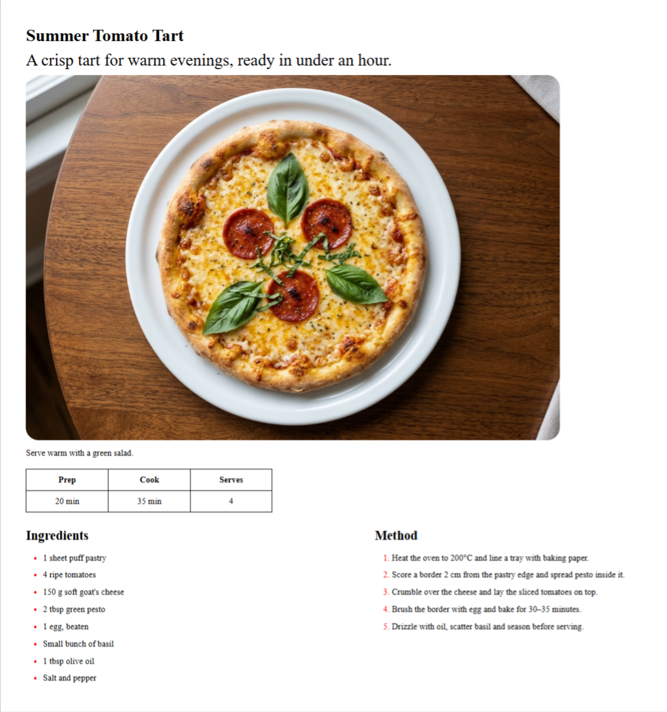
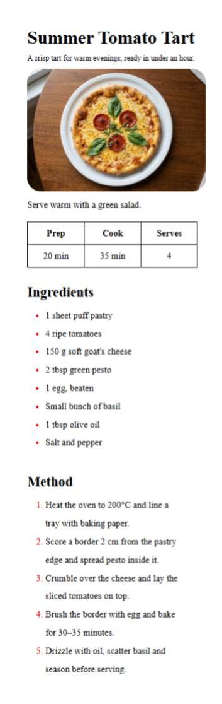

# Recipe Page

A recipe page for a summer tomato tart, built as part of a front-end
learning path.

**[→ Live demo](https://YOUR-USERNAME.github.io/recipe-page/)**

## What's in it

- An `<h1>` with the dish name and an intro paragraph
- A `<figure>` with a captioned photo of the finished tart
- Prep / cook / serves displayed as a `<table>` with three columns
- Eight ingredients in a `<ul>`, five method steps in an `<ol>`
- Markers coloured with `::marker`
- Flexbox layout with wrapping below desktop

## Known issues / next steps

This version was built before I learned a few things about semantic HTML.
The following are known and will be fixed in a follow-up commit:

- Prep / cook / serves should use `<dl>` with `<dt>`/`<dd>` pairs, not a
  `<table>`. A table implies row-and-column data where the grid carries
  meaning; three independent key-value pairs are a description list.
- Times need `<time datetime="PT20M">` so they're machine-readable.
- The hero image uses `width` with `vw` units — it should use
  `max-width: 100%; height: auto` so it respects its container.
- The two-column layout uses `flex-wrap` — a `@media (min-width: 768px)`
  query with `grid-template-columns: 1fr 2fr` would give explicit
  proportions and a proper breakpoint.
- `alt=""` on the hero image should describe the dish (empty alt means
  "decorative", which this image is not).

## What I'm practising

- Choosing the right list element for different kinds of content
- Styling `::marker` without losing the meaning of the list
- Responsive images and layout breakpoints

## Tech

Plain HTML and CSS. No frameworks, no build step.

